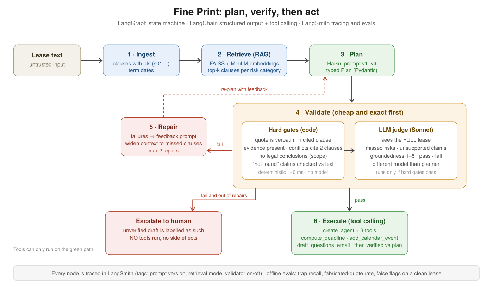

# Fine Print

A Python CLI that reads a synthetic apartment lease and turns it into a verified action plan: risky clauses, contradictions between clauses, deadlines, and questions to ask the landlord. The application uses Claude Haiku 5.5 for planning and tool calling and Claude Sonnet 5.5 for judging, with LangGraph controlling validation, a bounded repair loop, and the point at which tools are allowed to run.

> All leases in this repo are synthetic. Nothing here is legal advice.

## What it does

- **Ingest and retrieve (RAG):** splits the lease into clauses (regex on `SECTION n. TITLE.`), embeds them into FAISS, and pulls the top 2 clauses for each of 14 risk categories. `--retrieval full` skips retrieval and is the ablation.
- **Planner (Haiku 5.5):** returns a typed `Plan` (Pydantic, tool-calling mode). Every item carries a category, severity, explanation, and a verbatim quote with its clause id. Prompts are versioned v1 to v4, and each version adds exactly one idea.
- **Deterministic hard gates (Python):** category is valid, evidence is present, a conflict cites two clauses, each quote appears word for word in the clause it cites (only whitespace and typography are normalized), quotes are at least 20 characters, deadlines have a spec, explanations make no legal conclusions, and "not found" claims are checked by keyword. These cannot be argued with.
- **LLM judge (Sonnet 5.5):** a different, stronger model than the planner, and it sees the full lease. It scores groundedness 1 to 5, checks scope, and lists missed risks and unsupported claims.
- **Repair loop (LangGraph):** a failed plan goes back to the planner with the gate failures and the judge's critique, and the context is widened to the clauses the judge said were missed. At most 2 repairs. If it still fails, the run escalates to a human with zero side effects.
- **Executor (tools, only on the pass edge):** `compute_deadline`, `add_calendar_event` (writes an `.ics`), and `draft_questions_email`, called through `create_agent`. Afterwards Python verifies that the calendar events and the email's question count match the plan.

The distinctive design choice is **plan, then validate, then act**. The model decides what to flag; Python decides whether the evidence is real. The planner writes quotes, and a string comparison checks them against the clause, so a fabricated quote cannot pass however convincing the explanation sounds. Tools sit behind the validation edge, so a plan that fails never creates a calendar event or an email.

## Quickstart

You'll need Python 3.10 or newer and an Anthropic API key (console.anthropic.com/settings/keys). A LangSmith key is optional.

1. Clone the repository and go into it:

```
git clone <this-repo-url>
cd fineprint
```

2. Create the environment and install dependencies, then activate it:

```
make setup
source .venv/bin/activate
```

You'll know it worked if your prompt now starts with `(.venv)`.

3. Add your API key. `make setup` creates `.env` from `.env.example`; open it and replace the placeholder:

```
ANTHROPIC_API_KEY=your-key-here
```

`.env` is in `.gitignore`. Never commit it or paste a key into source code.

4. Verify the install with the test suite (no API key or network needed):

```
make test
```

You should see `54 passed`. If that works, your environment is set up correctly.

5. Analyze a lease (this one calls the API):

```
python -m fineprint analyze data/leases/lease_a.txt
```

### Troubleshooting

- **API errors (for example billing or rate limits)**: these are deliberately not retried or hidden; the run fails with the original error so an outage is never mistaken for a content failure.
- **`ANTHROPIC_API_KEY` is not set**: you skipped step 3, or `.env` still has the placeholder.
- **Embedding model download fails (Hugging Face unreachable)**: set `FINEPRINT_EMBEDDINGS=hashing` for the offline lexical fallback. Retrieval quality is lower.
- **`ModuleNotFoundError`**: the virtual environment is not activated. Re-run step 2.
- **Passing `temperature` errors out**: the current Claude models reject it, so the code never sends it.

## All CLI options

```
python -m fineprint analyze data/leases/lease_b.txt --prompt v4 --retrieval rag --move-in 2026-12-01 --out outputs
```

| Flag | Meaning |
|---|---|
| `lease` (positional) | Path to the lease text file. |
| `--prompt` | Prompt version `v1` to `v4` (default `v4`). |
| `--retrieval` | `rag` (per-category top-k) or `full` (whole lease in context). |
| `--no-validator` | Ablation: accept the first draft without validation. |
| `--no-execute` | Skip the tool-calling executor (plan and validate only). |
| `--move-in` | Move-in date `YYYY-MM-DD` (defaults to the lease start). |
| `--out` | Directory where the `.ics` and email draft are written (default `outputs`). |
| `--json` | Print the plan as JSON instead of Markdown. |

Evaluation entry points: `make eval` (`python -m evals.run_evals --grid default`, add `--langsmith` to log experiments) and `make calibrate` (`python -m evals.calibrate_judge --repeats 3`).

## Architecture

See `docs/architecture.png`. LangGraph owns the control flow: `ingest -> retrieve -> plan -> validate -> (repair | escalate | execute)`. The judge provides critique; it cannot override the deterministic gates, and tools run only on the pass edge.



## Prompt versions

| Version | Adds |
|---|---|
| v1 | Baseline: task and output schema only. |
| v2 | Verbatim-quote requirement. |
| v3 | Checklist of categories, severity rubric, `not_found` handling, no legal advice. |
| v4 | Explicit procedure, "do not flag standard terms", and one few-shot example on an unrelated topic (bounced-payment fees) to avoid leaking planted traps. |

## Prompt engineering

All prompts live in `fineprint/prompts.py`. The planner prompt is built in four cumulative versions so any change in results can be attributed to one idea:

- **v1, baseline:** "list the risks." Deliberately minimal.
- **v2, grounding:** every item must carry a clause id and a quote copied character for character. This is the rule the hard gate later enforces mechanically.
- **v3, structure:** the 14-category checklist (injected from `config.RISK_CATEGORIES`), a severity rubric with concrete thresholds (for example, "could cost more than one month's rent" is high), definitions of the four item kinds, an abstention path (`not_found`, "do NOT invent a risk"), and a no-legal-advice scope rule.
- **v4, procedure and calibration:** a numbered method (find clauses, separate standard terms from tenant-unfavourable ones, compare sections for contradictions, extract deadlines, quote the shortest span, re-read each quote against its clause, order by severity), an explicit "do not flag standard terms" instruction, and one worked example. The example uses a different lease and topics that are not planted traps, so the eval is not contaminated.

Other prompt design choices:
- **Repair prompt:** on a failed draft, the planner is re-prompted with the exact gate failures and judge critique as a bulleted list and told to keep what was correct.
- **Judge prompt:** a rubric with an explicit fail rule (any missed high-impact risk, unreported contradiction, scope violation, or groundedness below 4), plus "do not list standard terms" and "do not invent risks" to limit over-flagging.
- **Executor prompt:** forbids selecting a subset of questions or inventing dates, a rule added after the executor emailed 1 of about 12 questions in a live run.
- **Schema as prompt:** Pydantic field descriptions are sent to the model, so they carry part of the grounding rule even in v1.


## Judge design

The judge is a different model from the planner (Sonnet 5.5 against Haiku 5.5) and reads the whole lease, so it can notice clauses retrieval never surfaced. It returns structured output via `json_schema`: groundedness 1 to 5, `scope_ok`, `missed_risks`, `unsupported_claims`, and a verdict. Anything it names as missed widens the planner's context on the next repair.

The judge is not trusted on its own. Deterministic facts win: a quote that is not in the clause fails no matter what the judge says. Calibration is built to test the judge without human labels by feeding it plans with known defects (a swapped quote, a dropped trap, an invented claim).

Honest limitations: degrading a good plan is easier to detect than real planner mistakes, so calibration measures a floor. In the one live run, the judge passed a plan whose pet-clause explanation added a claim about emotional-support animals that the quoted text does not make. Hand-labelling a sample of real outputs is the next step.

## The data

`data/build_leases.py` generates five synthetic leases and records ground truth in `data/traps.json`: 16 planted traps in four leases (auto-renewal buried in the term clause, repair cost-shifting, a late-fee conflict between two sections, one-way attorney fees, and so on) plus one clean lease with no traps, which measures false alarms. A test asserts every trap's evidence sentence appears verbatim in its lease.


## Known limitations

- **Clause segmentation is regex-based** on the synthetic format. Real leases need PDF/OCR handling and layout-aware segmentation.
- **The lease is untrusted input.** Typed output, an unfoolable quote check, and tools that run only on validated plans reduce the risk, but explanation text is not hardened against prompt injection.
- **Synthetic data is easier than real data.** The few-shot example in v4 uses a topic that is not a planted trap, to avoid leakage.
- **"Extra flags" overstates false positives:** a flag matching no planted trap may still be legitimate.
- **RAG is arguably overkill for a 600-word lease.** It is justified by multi-document scaling and by making retrieval measurable on its own; the `full` ablation exists to quantify it.
- `langchain-community` (the FAISS wrapper) emits a sunset deprecation warning. `InMemoryVectorStore` from `langchain-core` is a one-file swap in `retrieval.py`.

## Tests

```
make test
```

54 tests use a scripted fake chat model (`tests/fakes.py`), so they need no API key and make no network calls. They cover the validators (including paraphrase rejection), the full graph (repair loop, escalation with zero side effects, judge-triggered context widening, parse-flake handling, API errors propagating), tool calling through `create_agent`, a concurrent-write regression test for the `.ics` file, metrics, the eval harness, and LangSmith's `evaluate()` run offline.

## What I would build with two more hours

- Compare `--retrieval rag` against `full` on longer, multi-document leases, where retrieval should matter.
- Hand-label a sample of real plans to measure judge agreement with a human.
- A second judge from a different model family to reduce same-model bias.
- Layout-aware ingestion for real PDFs, and an injection test suite for the lease text.

## Project layout

```
fineprint/              graph.py         LangGraph pipeline and repair loop
                        validators.py    deterministic hard gates
                        prompts.py       planner v1-v4, judge, executor prompts
                        llm.py           model setup, parse retries, planner and judge calls
                        retrieval.py     FAISS and hashing-fallback embeddings
                        tools.py         deadline, calendar, email tools
                        schemas.py       Pydantic Plan and JudgeVerdict models
                        metrics.py       eval metrics
                        calibration.py / synth.py   judge calibration with degraded plans
                        cli.py           CLI entry point
evals/                  run_evals.py, evaluators.py, calibrate_judge.py
data/                   build_leases.py, leases/*.txt, traps.json
tests/                  54 offline tests
docs/                   architecture.png/.svg
